# 勸你善良咕咕雞：穩定性與正常運作修復計畫

本計畫專注於**「系統穩定、安全無洩漏、正常運作」**，不牽涉遊戲數值平衡或複雜玩法的改動，旨在將此由 AI Studio 導出的原型整理為具備工業級穩定度與乾淨架構的 React + Vite 前端應用。

---

## 核心目標 (Goal Description)

1. **清除幽靈依賴與配置錯誤**：移除完全未使用的服務端與 AI 庫（`@google/genai`、`express` 等），修正 `typescript` 版本錯誤，更正專案資訊。
2. **根治 60 FPS React Render Thrashing**：解決 `GameCanvas` 每一幀發送 `onStatsEvent` 導致全域 `App.tsx` 每秒重渲染 60 次的嚴重 CPU/GPU 負擔。
3. **消除 Web Audio API 記憶體洩漏**：修復開火音效每次建立但從未釋放的 LFO 振盪器節點，加入分頁可見性切換（Visibility API）暫停。
4. **解鎖全成就與十誡閉環**：修復守則 6~10 無任何觸發源導致十誡成就無法達成的邏輯死鎖。
5. **解耦 Canvas 迴圈與升級狀態**：避免商店購買升級時頻繁銷毀重建 Canvas Animation Loop。

---

## 使用者審查重點 (User Review Required)

> [!IMPORTANT]
> 1. **移除後端與 Gemini 依賴**：本專案為 100% 純前端 Canvas 遊戲，無任何服務端或 Gemini API 呼叫。計畫將從 `package.json` 中移除 `@google/genai`、`express`、`@types/express`、`tsx`、`dotenv`、`motion`。
> 2. **規則 6~10 解鎖機制補齊**：原代碼 5 種敵人只綁定了守則 1~5，守則 6~10 完全沒有觸發源。計畫將守則 6~10 分配至波數通關結算（通關第 1~5 波依序解鎖 6~10 條），使十誡成就可正常達成，且不破壞現有敵人架構。

---

## 架構與狀態流向改善 (Architecture & Flow)

```mermaid
flowchart TD
    subgraph Before["修復前 (嚴重 Render Thrashing)"]
        CanvasLoop1["Canvas 60FPS 迴圈"] -->|每一幀發送 laser_tick / pacifist_tick| StatsEvent1["onStatsEvent()"]
        StatsEvent1 -->|每一幀呼叫| SetAch1["setAchievements() (返回新陣列)"]
        SetAch1 -->|每秒 60 次| ReRender1["App.tsx 全域重渲染 (CPU 高負載)"]
    end

    subgraph After["修復後 (狀態解耦與節流)"]
        CanvasLoop2["Canvas 60FPS 迴圈"] -->|內部 Ref 追蹤統計| InternalRef["Canvas Internal Stats (無 React 開銷)"]
        InternalRef -->|僅在整數秒/里程碑達成/過關結算時觸發| StatsEvent2["onStatsEvent(throttled)"]
        StatsEvent2 -->|進度實質變更才更新| SetAch2["setAchievements(無變更則返回原陣列)"]
        SetAch2 -->|低頻平滑更新| ReRender2["App.tsx 流暢穩定運行"]
    end
```



---

## 具體修復方案 (Proposed Changes)

### 1. 專案依賴與配置層 (Configuration & Dependencies)

#### [MODIFY] [package.json](file:///Users/isaacclarke/.gemini/antigravity/scratch/I-advise-you-to-be-kind-Clucky/package.json)
- 更名 `"name": "react-example"` ➔ `"be-virtuous-zanna"`。
- 移除無用的依賴：`@google/genai`, `express`, `@types/express`, `dotenv`, `tsx`, `motion`。
- 修正 TypeScript 版本：`"typescript": "^7.0.2"`（不存在）➔ `"typescript": "^5.7.2"`。
- 修正 clean 指令：`"clean": "rm -rf dist server.js"` ➔ `"clean": "rm -rf dist"`。

#### [MODIFY] [metadata.json](file:///Users/isaacclarke/.gemini/antigravity/scratch/I-advise-you-to-be-kind-Clucky/metadata.json)
- 移除 `"MAJOR_CAPABILITY_SERVER_SIDE_GEMINI_API"` 宣告，避免部署或工具檢查時因找不到後端而告警。

---

### 2. 效能與狀態更新層 (GameCanvas & App.tsx)

#### [MODIFY] [src/components/GameCanvas.tsx](file:///Users/isaacclarke/.gemini/antigravity/scratch/I-advise-you-to-be-kind-Clucky/src/components/GameCanvas.tsx)
1. **解除 Canvas Loop 對 `upgrades` 的依賴重繪**：
   - 建立 `upgradesRef = useRef(upgrades)`，每次 render 同步更新 ref。
   - Canvas loop 讀取 `upgradesRef.current`，從 `useEffect` 依賴陣列中移除 `upgrades`，避免升級時不斷銷毀並重新綁定 EventListener。
2. **移除每幀高頻 `onStatsEvent` 派發**：
   - 在 `gameStateRef` 中維護統計數據（開火次數、命中次數、未開火秒數）。
   - `pacifist_tick`：改為內部累積秒數，僅在秒數整數跳號（且小於等於上限）或特定檢查點才發送。
   - `laser_tick`：改為在內部累積統計命中率，達成 80% 門檻時才單次發出 achievement 觸發信號。
3. **波數通關時補齊守則 6~10 解鎖**：
   - 在波數結算 `totalRemaining === 0` 時，根據當前 wave 自動解鎖第 `5 + wave` 條守則（第 1 波解鎖第 6 條，至第 5 波解鎖第 10 條）。

#### [MODIFY] [src/App.tsx](file:///Users/isaacclarke/.gemini/antigravity/scratch/I-advise-you-to-be-kind-Clucky/src/App.tsx)
1. **防止 `setAchievements` 無謂重渲染**：
   - 在 `setAchievements` 的 map 中加入不變守衛：若 `currentProgress` 未實質改變且未觸發解鎖，直接返回舊物件，不產生新參照。
2. **確保 `handleCanvasStatsEvent` 參照穩定**。

---

### 3. 音效引擎層 (Audio Engine & Lifecycle)

#### [MODIFY] [src/utils/audio.ts](file:///Users/isaacclarke/.gemini/antigravity/scratch/I-advise-you-to-be-kind-Clucky/src/utils/audio.ts)
1. **徹底解決 LFO 振盪器洩漏**：
   - 新增 `laserLfo: OscillatorNode | null` 與 `laserLfoGain: GainNode | null` 成員變數。
   - 在 `stopLaser()` 中，同步執行 `laserLfo.stop()` 與 `disconnect()` 並清空參照。
2. **分頁切換背景處理 (Visibility Management)**：
   - 監聽 `visibilitychange` 事件：當分頁隱藏（`document.hidden`）時，自動暫停 BGM 與音效；切換回來時恢復，防止背景持續嗶嗶作響與浪費電量。

---

## 驗證計畫 (Verification Plan)

### 自動化檢查 (Automated Verification)
1. **類型檢查**：
   ```bash
   npm run lint  # 或 npx tsc --noEmit
   ```
   確保無 TypeScript 編譯或語法錯誤。
2. **構建打包測試**：
   ```bash
   npm run build
   ```
   確保 Vite 打包產物乾淨產出於 `dist/`，無遺留伺服器代碼或遺失套件。

### 手動行為驗證 (Manual Verification)
1. **CPU / 渲染效能驗證**：
   - 開啟遊戲按住滑鼠開火，觀察控制台與開發者工具渲染面板，確認不再發生每秒 60 次全 App 重新渲染。
2. **音效生命週期驗證**：
   - 連續點擊開火 30 次，確認無堆疊失控的 LFO 振盪器；切換到其他瀏覽器分頁確認音效正常暫停。
3. **規則與成就閉環驗證**：
   - 透過遊戲進度（波數結算與幹部感化），確認 10 條守則皆能順利解鎖，且「十誡全書掌門」與其餘成就能正常達成與領取獎勵。
